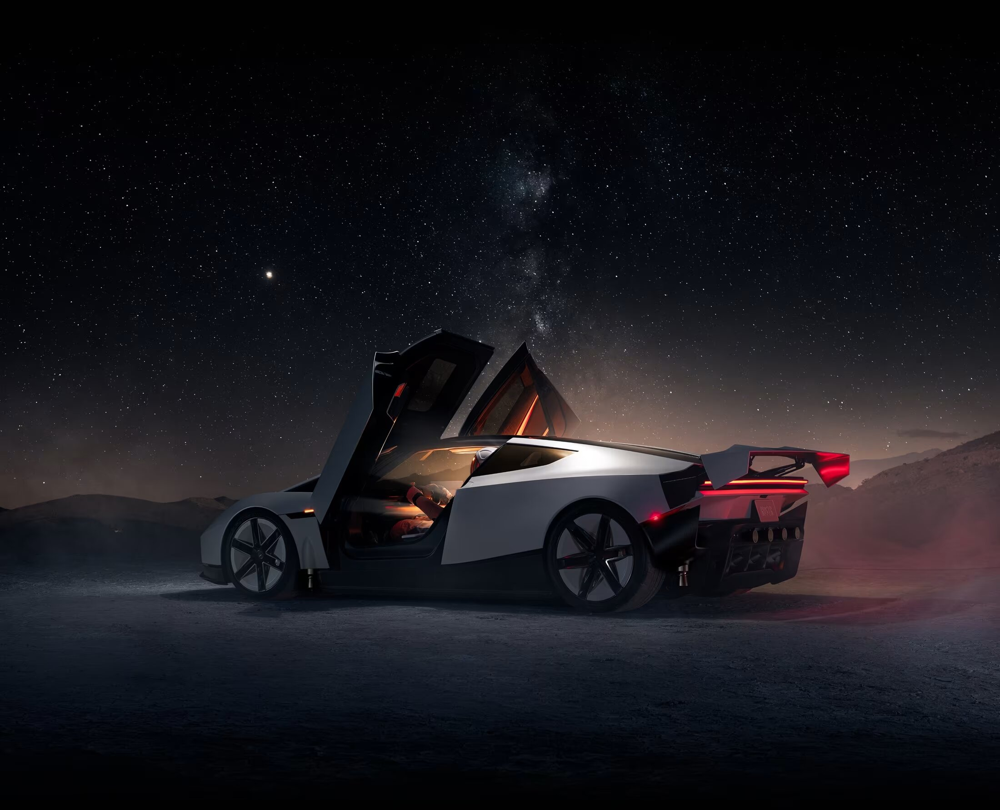

# Tesla Roadster for Omarchy

A dark Omarchy theme inspired by cream aluminium, graphite shadows, red taillights, and warm amber illumination.



*Wallpaper preview, not a desktop screenshot. Seven wallpapers are included.*

## Design

The palette takes its cues from the included Roadster wallpapers, adapted for comfortable dark-interface reading rather than exact automotive paint codes.

- Graphite backgrounds keep shadows neutral instead of brown.
- Cream and champagne text echo illuminated aluminium surfaces.
- Warm red, amber, and orange accents reflect taillights and interior lighting.
- ANSI slots normally named green, blue, cyan, and magenta use warm material reflections rather than their conventional hues.
- The structural accent is muted champagne, keeping active window borders restrained.

## Palette

| Role | Color |
| --- | --- |
| Background | `#151516` |
| Deeper / deepest surface | `#0E0E0F` / `#09090A` |
| Raised surface | `#2C2C2D` |
| Foreground | `#C9C3B8` |
| Bright foreground | `#EEE5D6` |
| Accent | `#B7AA94` |
| Selection | `#42413F` |
| Muted text | `#9E9A92` |
| Taillight red | `#DC655E` |
| Amber | `#E8BB75` |
| Orange | `#E69A68` |

## Install

For Omarchy releases supporting `colors.toml`:

```sh
omarchy theme install https://github.com/xvvhang/omarchy-tesla-roadster-theme
```

Switch later through the theme menu or run:

```sh
omarchy theme set tesla-roadster
```

**Back up an existing theme first:** Omarchy's installer may replace `~/.config/omarchy/themes/tesla-roadster/`.

Omarchy generates supported application configurations from the palette. This repository does not install application plugins, change GTK accent settings, or add custom window-opacity and blur rules.

## Wallpapers

Seven backgrounds are available in `backgrounds/0.jpg` through `backgrounds/6.jpg`. To cycle through them:

```sh
omarchy theme bg next
```

`preview.jpg` provides the theme-selector preview. `icons.theme` selects `Yaru-red`, which must already be installed on your system.

## Contents

```text
backgrounds/    Seven Roadster wallpapers
colors.toml     Theme palette
icons.theme     Icon theme selection
preview.jpg    Wallpaper preview for the theme selector
README.md       Installation and palette reference
```

## Attribution

This is an unofficial theme and is not affiliated with or endorsed by Tesla or Omarchy. Vehicle names, trademarks, and wallpaper artwork belong to their respective rights holders. No ownership of the included artwork is claimed.

Packaged and maintained by [Alec Xu / @xvvhang](https://github.com/xvvhang).
